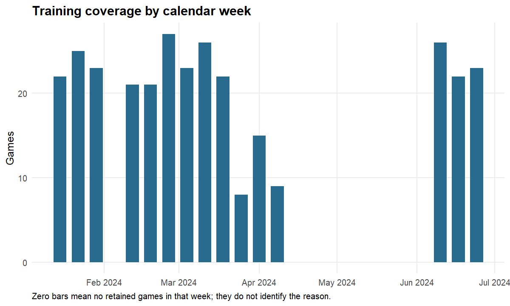
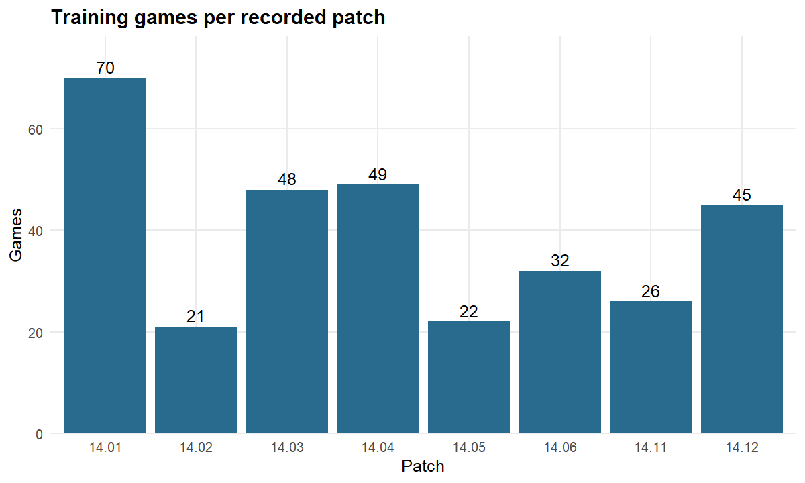
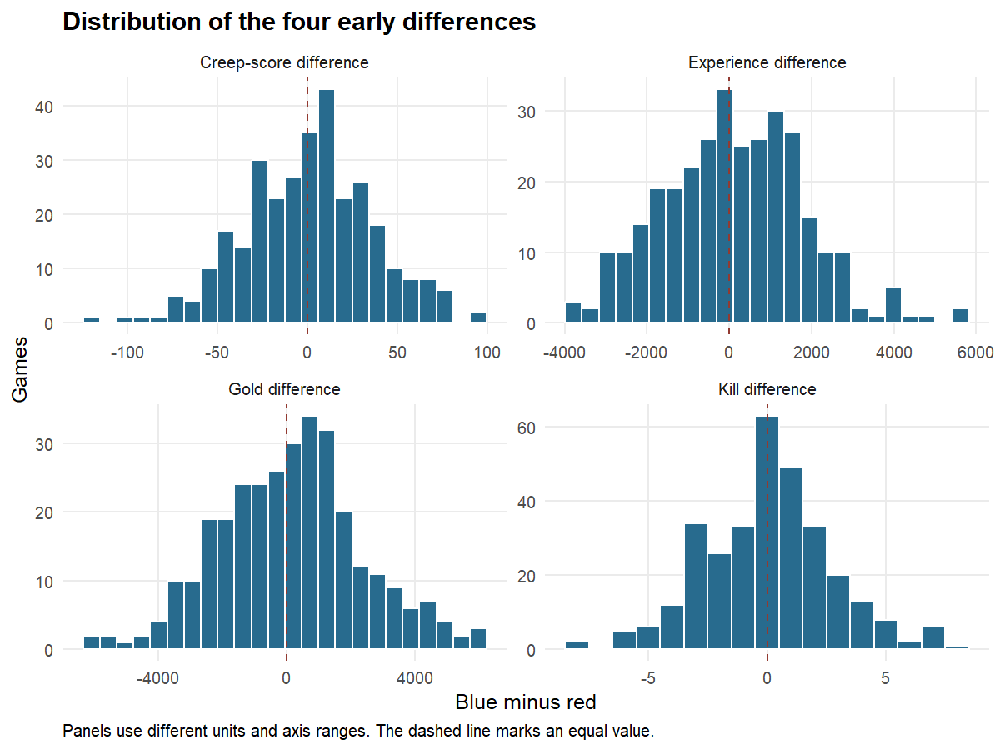
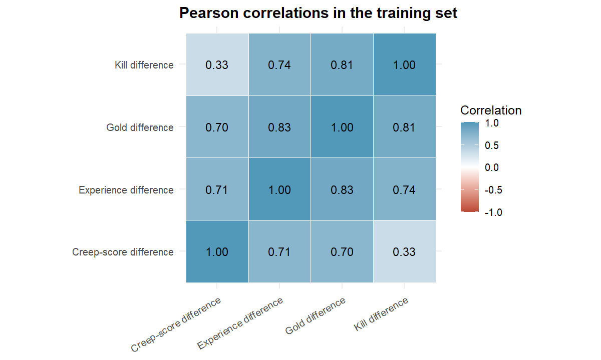
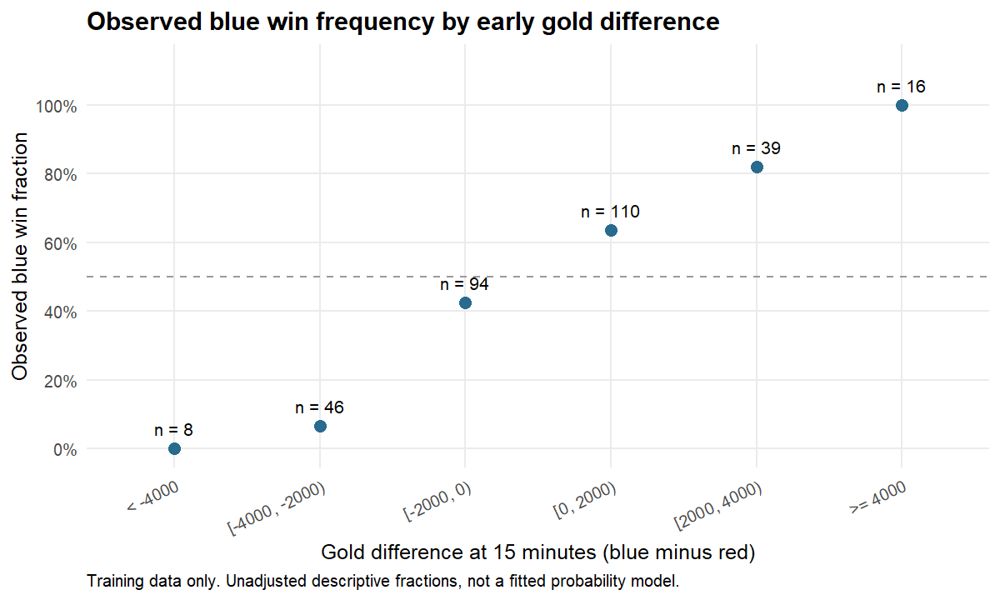
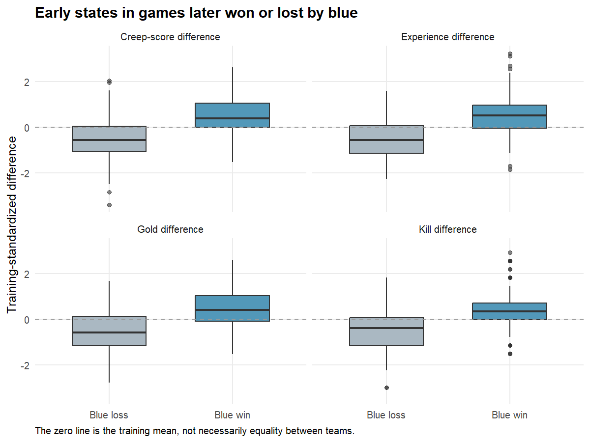
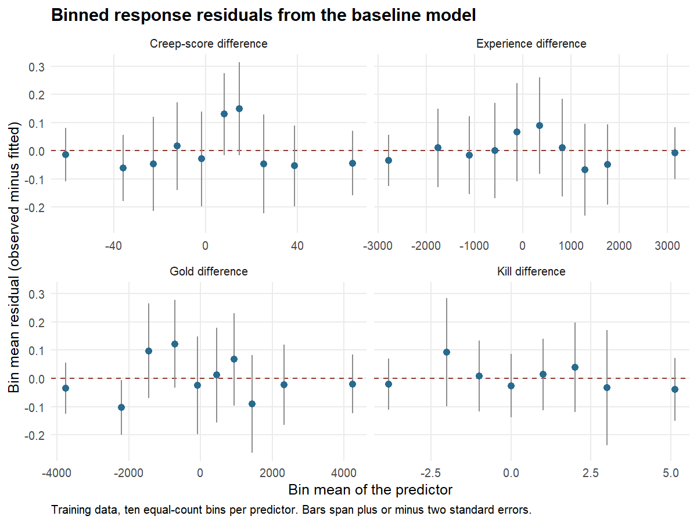
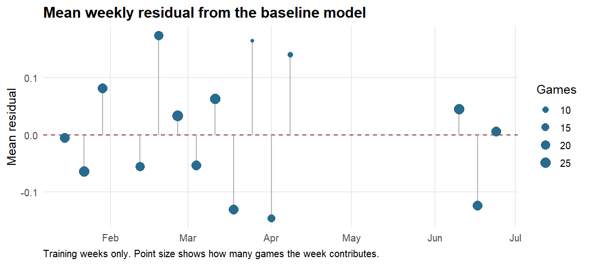
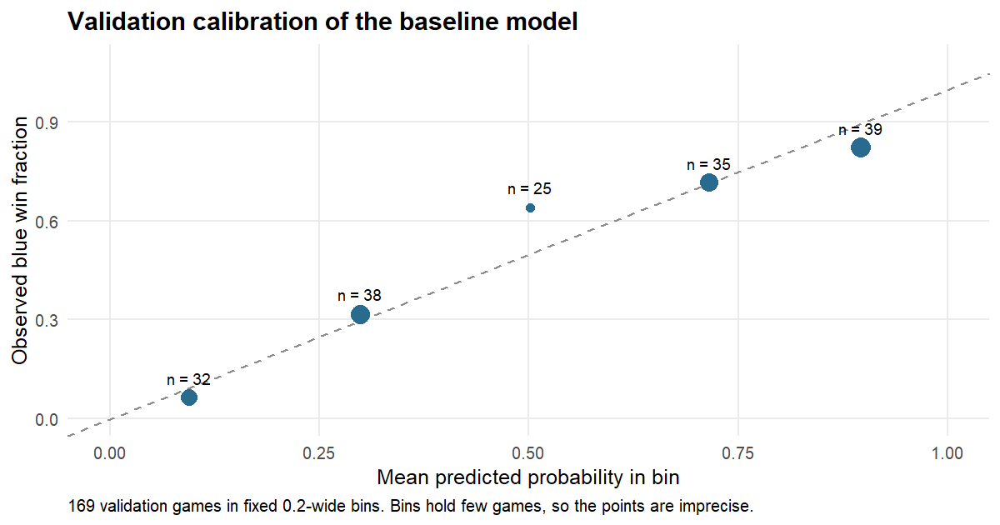
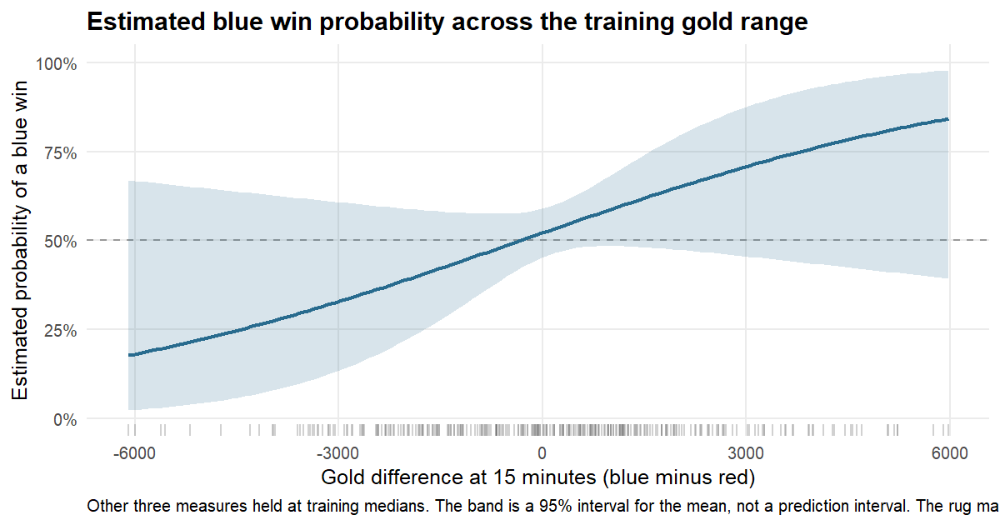

Early Advantages and Match Outcomes in League of Legends
================
Sicheng Yi
October 20, 2026

- [1. Purpose and current scope](#1-purpose-and-current-scope)
- [2. Sources and decisions made before
  analysis](#2-sources-and-decisions-made-before-analysis)
- [3. Data preprocessing in R](#3-data-preprocessing-in-r)
  - [3.1 Verify and read the frozen
    files](#31-verify-and-read-the-frozen-files)
  - [3.2 Check keys and select the original candidate
    pool](#32-check-keys-and-select-the-original-candidate-pool)
  - [3.3 Pair sides and apply the recorded quality
    rules](#33-pair-sides-and-apply-the-recorded-quality-rules)
  - [3.4 Construct one analysis row per
    game](#34-construct-one-analysis-row-per-game)
- [4. Training, validation and test
  design](#4-training-validation-and-test-design)
  - [4.1 Fit preprocessing parameters using training data
    only](#41-fit-preprocessing-parameters-using-training-data-only)
- [5. Training-set exploratory
  analysis](#5-training-set-exploratory-analysis)
  - [5.1 Size, outcome balance and repeated
    teams](#51-size-outcome-balance-and-repeated-teams)
  - [5.2 Coverage over weeks and
    patches](#52-coverage-over-weeks-and-patches)
  - [5.3 Predictor distributions and unusual
    values](#53-predictor-distributions-and-unusual-values)
  - [5.4 Correlation and redundancy among
    predictors](#54-correlation-and-redundancy-among-predictors)
  - [5.5 Gold difference and observed win
    frequency](#55-gold-difference-and-observed-win-frequency)
  - [5.6 Predictor distributions by final
    outcome](#56-predictor-distributions-by-final-outcome)
  - [5.7 Implications for the next
    analysis](#57-implications-for-the-next-analysis)
- [6. Save reproducible preprocessing
  outputs](#6-save-reproducible-preprocessing-outputs)
- [7. Logistic regression baseline](#7-logistic-regression-baseline)
  - [7.1 Scoring code shared by every later
    model](#71-scoring-code-shared-by-every-later-model)
  - [7.2 Baseline fit and reference
    forecast](#72-baseline-fit-and-reference-forecast)
  - [7.3 Collinearity among the
    predictors](#73-collinearity-among-the-predictors)
  - [7.4 Separation and convergence](#74-separation-and-convergence)
  - [7.5 Functional form](#75-functional-form)
  - [7.6 Leverage and influential
    games](#76-leverage-and-influential-games)
  - [7.7 Residual summaries by team and by
    week](#77-residual-summaries-by-team-and-by-week)
  - [7.8 Validation performance](#78-validation-performance)
  - [7.9 Estimated probabilities across the gold
    range](#79-estimated-probabilities-across-the-gold-range)
  - [7.10 Saved outputs and what section 8
    inherits](#710-saved-outputs-and-what-section-8-inherits)
- [8. Bayesian model, random forest and supporting clustering —
  pending](#8-bayesian-model-random-forest-and-supporting-clustering--pending)
- [9. Frozen specification and final testing —
  pending](#9-frozen-specification-and-final-testing--pending)
- [10. Discussion and conclusions —
  pending](#10-discussion-and-conclusions--pending)
- [Reproducibility information](#reproducibility-information)

## 1. Purpose and current scope

This is the main analysis file for the project. All preprocessing and
statistical analyses are written here, section by section. The current
version completes preprocessing, exploratory data analysis (EDA) of the
initial training set, and the logistic regression baseline with its
diagnostics and validation scores. It does not score either 2025 test
set; those partitions are read for structural checks only and stay
unscored until the specification is frozen in section 9.

The outcome is whether the blue-side team wins a game. The prediction
time is 15 minutes. The four predictors are blue-minus-red differences
in gold, kills, experience points, and creep score. Creep score counts
minions and monsters killed. A game is one observation; the two teams in
a game are not independent observations.

The three research questions concern the relationship between early
advantages and winning, differences across game patches, and prediction
in a later year and another league. Patch means the recorded game
version. These are observational data, so an association does not
establish a causal effect.

The course folder does not currently contain lecture notes for this
capstone. The instructor’s proposal feedback and the revised analysis
plan guide this file. The historical ten-question list is not the
current analysis specification.

## 2. Sources and decisions made before analysis

The raw files are the saved September 2026 snapshot from
[ChainCC](https://chaincc.lol/free/data). The provider’s
[methodology](https://chaincc.lol/about/methodology) lists several
upstream sources. We use the local snapshot rather than silently
downloading a newer version. File-year labels do not always equal the
actual year of every game; we select games using the recorded match
date.

A previous source check compared 11 selected training games with Games
of Legends, covering eight patches, extreme gold differences, and one
zero creep-score difference. All 44 early-feature comparisons agreed.
Dates, sides, results, patch numbers, and durations also agreed. See the
[source-check report](../07_数据来源抽查记录.md) for game links and
evidence. This purposeful sample does not verify every record, and the
websites may share upstream errors.

We retain the following decisions from the approved design:

- Keep one blue-side record per paired game and define every difference
  as blue minus red.
- Exclude games with invalid early measurements. The Chinese league in
  the original candidate pool has nonpositive early gold and is not
  used.
- Keep valid extreme values and genuine zero differences. Do not trim or
  winsorize them merely because they are unusual.
- Stop for unexpected missing values, duplicate keys, or new
  inconsistencies rather than silently filling values or choosing one
  duplicate.
- Preserve raw team names and team IDs. Record known historical
  display-name differences separately; do not automatically merge team
  identities across years.
- Keep the fixed chronological and geographic splits. Learn centering
  and scaling only from the current training set.

These decisions are not chosen by comparing model performance. Any later
change that alters the cohort, outcome, or split must be recorded here
before final testing.

## 3. Data preprocessing in R

### 3.1 Verify and read the frozen files

We check each raw file against its saved SHA-256 hash. Reading
identifiers and patch codes as text preserves values such as `14.10`. A
changed file stops the analysis and requires a new data-version
decision.

``` r
manifest <- jsonlite::fromJSON(file.path(project_dir, "audit/source_manifest.json"))
source_files <- manifest$files
raw_paths <- file.path(project_dir, gsub("\\", "/", source_files$file, fixed = TRUE))
stopifnot(all(file.exists(raw_paths)))
actual_hash <- vapply(raw_paths, function(p) {
  digest::digest(file = p, algo = "sha256", serialize = FALSE)
}, character(1))
file_check <- data.frame(file = basename(raw_paths),
                         hash_matches = actual_hash == source_files$sha256)
stopifnot(all(file_check$hash_matches))
show_table(file_check)
```

| file                      | hash_matches |
|:--------------------------|:-------------|
| chaincc-teams-2024.csv.gz | TRUE         |
| chaincc-teams-2025.csv.gz | TRUE         |
| chaincc-teams-2026.csv.gz | TRUE         |

``` r
raw_list <- lapply(raw_paths, function(p) {
  read.csv(gzfile(p), colClasses = "character", check.names = FALSE,
           na.strings = c("", "NA"), stringsAsFactors = FALSE)
})
stopifnot(all(vapply(raw_list, function(x) identical(names(x), names(raw_list[[1]])),
                     logical(1))))
for (i in seq_along(raw_list)) raw_list[[i]]$source_file <- basename(raw_paths[i])
raw <- do.call(rbind, raw_list)
rownames(raw) <- NULL
```

The three files contain 59,184 team-game rows. This is not the number of
independent games.

### 3.2 Check keys and select the original candidate pool

We use the date part of the source timestamp without converting time
zones. The exact timestamp convention has not been independently
verified. This preserves the recorded calendar dates used in the frozen
split. We do not use the filename or the source `year` field to assign
years.

``` r
numeric_fields <- c("gamelength", "goldat10", "goldat15", "golddiffat10",
                    "golddiffat15", "xpdiffat10", "xpdiffat15",
                    "csdiffat10", "csdiffat15", "killsat15", "deathsat15")
required_raw <- c("game_id", "date", "league", "patch", "side", "team_id",
                  "team_name", "result", "game_number", numeric_fields)
stopifnot(all(required_raw %in% names(raw)),
          !anyNA(raw[c("game_id", "side")]),
          all(raw$side %in% c("Blue", "Red")))
key <- paste(raw$game_id, raw$side, sep = "|")
stopifnot(!anyDuplicated(key), all(table(raw$game_id) == 2L))
raw$match_date <- as.Date(substr(raw$date, 1, 10))
stopifnot(!anyNA(raw$match_date))
candidate <- raw[format(raw$match_date, "%Y") %in% c("2024", "2025") &
                   raw$league %in% c("LCK", "LEC", "LPL"), ]
missing_required <- vapply(candidate[required_raw], function(x) {
  sum(is.na(x) | trimws(x) == "")
}, integer(1))
stopifnot(all(missing_required == 0L))
stopifnot(all(candidate$result %in% c("TRUE", "FALSE")))
candidate$result <- as.integer(candidate$result == "TRUE")
for (v in numeric_fields) {
  candidate[[v]] <- suppressWarnings(as.numeric(candidate[[v]]))
  stopifnot(all(is.finite(candidate[[v]])))
}
candidate$game_number <- as.integer(candidate$game_number)
stopifnot(!anyNA(candidate$game_number))
```

Here `LCK` means League of Legends Champions Korea; `LEC` means League
of Legends EMEA Championship, where EMEA refers to Europe, the Middle
East and Africa; and `LPL` means League of Legends Pro League in China.
The retained analysis uses the Korean and European regional leagues.

### 3.3 Pair sides and apply the recorded quality rules

We match the red record to the blue record by game ID. The one-unit
tolerance below reproduces the previous audit’s rounding check. Missing
cells have already been checked, so no imputation is applied. The old
audit checked both 10- and 15-minute snapshots; keeping that rule
preserves the frozen cohort even though the main prediction time is 15
minutes.

Deaths can exceed opposing kills because an execution need not give a
player kill credit. We therefore do not require deaths to equal opposing
kills. We flag the reverse inconsistency, where kills exceed the
opponent’s deaths.

``` r
blue <- candidate[candidate$side == "Blue", ]
red <- candidate[candidate$side == "Red", ]
red <- red[match(blue$game_id, red$game_id), ]
stopifnot(identical(blue$game_id, red$game_id),
          !anyDuplicated(blue$game_id), nrow(blue) == nrow(red))
diff_fields <- c("golddiffat10", "golddiffat15", "xpdiffat10",
                 "xpdiffat15", "csdiffat10", "csdiffat15")
flags <- data.frame(
  noncomplementary_result = blue$result + red$result != 1,
  nonpositive_early_gold = blue$goldat10 <= 0 | red$goldat10 <= 0 |
                           blue$goldat15 <= 0 | red$goldat15 <= 0,
  too_short = blue$gamelength <= 900 | red$gamelength <= 900,
  inconsistent_context = blue$date != red$date | blue$league != red$league |
                          blue$patch != red$patch | blue$gamelength != red$gamelength,
  nonopposite_differences = Reduce(`|`, lapply(diff_fields, function(v) {
    abs(blue[[v]] + red[[v]]) > 1
  })),
  inconsistent_gold = abs(blue$goldat15 - red$goldat15 - blue$golddiffat15) > 1 |
                       abs(blue$goldat10 - red$goldat10 - blue$golddiffat10) > 1,
  impossible_kill_count = blue$killsat15 > red$deathsat15 |
                           red$killsat15 > blue$deathsat15,
  identical_team_ids = blue$team_id == red$team_id
)
excluded <- rowSums(flags) > 0
quality_table <- data.frame(check = names(flags), flagged_games = colSums(flags))
show_table(quality_table)
```

| check                   | flagged_games |
|:------------------------|--------------:|
| noncomplementary_result |             0 |
| nonpositive_early_gold  |          1522 |
| too_short               |             0 |
| inconsistent_context    |             0 |
| nonopposite_differences |             0 |
| inconsistent_gold       |             0 |
| impossible_kill_count   |             0 |
| identical_team_ids      |             0 |

``` r
flow_by_league <- do.call(rbind, lapply(sort(unique(blue$league)), function(lg) {
  ix <- blue$league == lg
  data.frame(league = lg, candidate_games = sum(ix),
             excluded_games = sum(ix & excluded), retained_games = sum(ix & !excluded))
}))
show_table(flow_by_league)
```

| league | candidate_games | excluded_games | retained_games |
|:-------|----------------:|---------------:|---------------:|
| LCK    |            1037 |              0 |           1037 |
| LEC    |             600 |              0 |            600 |
| LPL    |            1522 |           1522 |              0 |

``` r
exclusion_ledger <- cbind(blue[c("game_id", "league", "match_date")], flags,
                         excluded = excluded)
# Stop if the exclusions differ from the previously audited snapshot.
stopifnot(nrow(blue) == 3159L, sum(excluded) == 1522L,
          all(blue$league[excluded] == "LPL"),
          all(flags$nonpositive_early_gold[excluded]))
```

All 1522 excluded candidate games are from the Chinese league and have
invalid early gold. Zero-filled early statistics in these games cannot
be treated as tied early states. This exclusion limits geographic scope;
it is not evidence about that league’s match performance. The table
counts rule flags separately, so flags should not be added together as
independent exclusions.

### 3.4 Construct one analysis row per game

The outcome is coded as 1 for a blue win and 0 for a blue loss. Gold,
experience and creep-score differences are supplied by the source and
have been checked against the paired records. The kill difference is
calculated from the two teams’ kill counts at 15 minutes. Final-game
totals and game duration are not predictors.

``` r
games <- data.frame(
  game_id = blue$game_id, match_date = blue$match_date,
  source_timestamp = blue$date, league = blue$league, patch = blue$patch,
  game_number = blue$game_number,
  blue_team_id = blue$team_id, red_team_id = red$team_id,
  blue_team_name_raw = blue$team_name, red_team_name_raw = red$team_name,
  blue_win = blue$result,
  gold15 = blue$golddiffat15,
  kills15 = blue$killsat15 - red$killsat15,
  experience15 = blue$xpdiffat15,
  creep15 = blue$csdiffat15,
  source_file = blue$source_file,
  stringsAsFactors = FALSE
)[!excluded, ]
games <- games[order(games$match_date, games$source_timestamp, games$game_id), ]
rownames(games) <- NULL
features <- c("gold15", "kills15", "experience15", "creep15")
stopifnot(nrow(games) == 1637L, !anyDuplicated(games$game_id),
          !anyNA(games), all(games$league %in% c("LCK", "LEC")),
          all(games$blue_win %in% 0:1))
natural_key <- paste(games$league, games$source_timestamp,
                     pmin(games$blue_team_id, games$red_team_id),
                     pmax(games$blue_team_id, games$red_team_id), games$game_number)
stopifnot(!anyDuplicated(natural_key))
day_pair_key <- paste(games$league, games$match_date,
                      pmin(games$blue_team_id, games$red_team_id),
                      pmax(games$blue_team_id, games$red_team_id), games$game_number)
ambiguous_day_key <- duplicated(day_pair_key) | duplicated(day_pair_key, fromLast = TRUE)
day_key_review <- games[ambiguous_day_key,
                        c("game_id", "source_timestamp", "league", "game_number")]
stopifnot(all(games$league[ambiguous_day_key] == "LEC"),
          all(format(games$match_date[ambiguous_day_key], "%Y") == "2024"))

# Verify the reconstruction against the earlier frozen cohort; do not replace it.
frozen <- readRDS(file.path(project_dir, "data/derived/eligible_games.rds"))
stopifnot(setequal(games$game_id, frozen$game_id))
frozen <- frozen[match(games$game_id, frozen$game_id), ]
old_fields <- c("golddiffat15", "killdiffat15", "xpdiffat15", "csdiffat15")
for (i in seq_along(features)) {
  stopifnot(all(games[[features[i]]] == frozen[[old_fields[i]]]))
}
stopifnot(all(games$blue_win == as.integer(frozen$result)))
```

A date-only duplicate check finds two pairs of European 2024 records
with the same day, team pair, and game number, but different IDs and
timestamps. These are outside model development. We retain and flag them
rather than assuming they are duplicates; their event identity has not
been independently resolved. The primary key remains game ID, and the
timestamp-based context key has no duplicates. A calendar date and game
number alone are not a safe deletion rule.

``` r
show_table(day_key_review)
```

| game_id         | source_timestamp    | league | game_number |
|:----------------|:--------------------|:-------|------------:|
| LOLTMNT04_33065 | 2024-03-25 17:01:20 | LEC    |           1 |
| LOLTMNT04_33099 | 2024-03-25 19:57:18 | LEC    |           1 |
| LOLTMNT05_59689 | 2024-06-30 15:58:11 | LEC    |           1 |
| LOLTMNT05_57548 | 2024-06-30 19:40:02 | LEC    |           1 |

``` r
dictionary <- data.frame(
  variable = c("blue_win", features, "patch", "match_date", "league",
               "blue_team_id / red_team_id", "game_id"),
  meaning = c("Final blue-side victory: 1 win, 0 loss",
              "Blue minus red gold at 15 minutes",
              "Blue kills minus red kills at 15 minutes",
              "Blue minus red experience at 15 minutes",
              "Blue minus red creep score at 15 minutes",
              "Recorded game-version code", "Recorded calendar date",
              "Competition code", "Source team identifiers", "Source game identifier"),
  unit_or_type = c("Binary", "Gold", "Kills", "Experience points", "CS count",
                   "Text/group", "Date", "Categorical", "Text", "Text"),
  role = c("Outcome", rep("Predictor", 4), "Later hierarchical grouping",
           "Split and dependence checks", "Split only", "Coverage/dependence checks", "Pairing/key")
)
show_table(dictionary)
```

| variable | meaning | unit_or_type | role |
|:---|:---|:---|:---|
| blue_win | Final blue-side victory: 1 win, 0 loss | Binary | Outcome |
| gold15 | Blue minus red gold at 15 minutes | Gold | Predictor |
| kills15 | Blue kills minus red kills at 15 minutes | Kills | Predictor |
| experience15 | Blue minus red experience at 15 minutes | Experience points | Predictor |
| creep15 | Blue minus red creep score at 15 minutes | CS count | Predictor |
| patch | Recorded game-version code | Text/group | Later hierarchical grouping |
| match_date | Recorded calendar date | Date | Split and dependence checks |
| league | Competition code | Categorical | Split only |
| blue_team_id / red_team_id | Source team identifiers | Text | Coverage/dependence checks |
| game_id | Source game identifier | Text | Pairing/key |

The source check found historical display-name differences for DN
SOOPers/Kwangdong Freecs and HANJIN BRION/OK BRION. We preserve raw
names in this file and use IDs for counting teams. No team-name
correction is used as a model feature. These specific matches do not
validate every historical team identity.

## 4. Training, validation and test design

We use a chronological split within the Korean league. Games from
January through June 2024 form the initial training set. Games from July
through September 2024 form the validation set. This asks whether
choices made with earlier games remain useful for later games from the
same league. It also reduces leakage that would arise from randomly
mixing earlier and later games.

There are two separate 2025 test sets. Korean games measure transfer to
a later year within the source league. European regional games measure
transfer to another league and a later year. European games from 2024
remain outside model development. All matches from the same series occur
within one partition under these date rules; we verify that property
below.

After model settings are chosen using only training and validation data,
we will refit the selected recipe on all 482 Korean games from 2024.
This is the union of training and validation, not an extra independent
dataset. Both 2025 tests remain outside preprocessing choices, tuning,
prior selection, cluster-count selection, and calibration adjustments.

``` r
games$partition <- NA_character_
games$partition[games$league == "LCK" & games$match_date >= as.Date("2024-01-01") &
                  games$match_date < as.Date("2024-07-01")] <- "train"
games$partition[games$league == "LCK" & games$match_date >= as.Date("2024-07-01") &
                  games$match_date < as.Date("2024-10-01")] <- "validation"
games$partition[games$league == "LCK" & format(games$match_date, "%Y") == "2025"] <- "test_time"
games$partition[games$league == "LEC" & format(games$match_date, "%Y") == "2025"] <- "test_external"
games$partition[games$league == "LEC" & format(games$match_date, "%Y") == "2024"] <- "unused"
partition_order <- c("train", "validation", "test_time", "test_external", "unused")
stopifnot(!anyNA(games$partition))
split_ids <- lapply(partition_order, function(p) games$game_id[games$partition == p])
names(split_ids) <- partition_order
stopifnot(identical(as.integer(lengths(split_ids)), c(313L, 169L, 555L, 306L, 294L)))
old_ids <- readRDS(file.path(project_dir, "audit/proposed_teacher_split_ids.rds"))
stopifnot(all(vapply(seq_along(split_ids), function(i) {
  setequal(split_ids[[i]], old_ids[[i]])
}, logical(1))))
stopifnot(!anyDuplicated(unlist(split_ids, use.names = FALSE)))
# Conservative series proxy: same date, league and unordered pair of teams.
series_proxy <- paste(games$league, games$match_date,
                      pmin(games$blue_team_id, games$red_team_id),
                      pmax(games$blue_team_id, games$red_team_id))
stopifnot(all(vapply(split(games$partition, series_proxy), function(p) {
  length(unique(p)) == 1L
}, logical(1))))
train <- games[games$partition == "train", ]
validation <- games[games$partition == "validation", ]
test_time <- games[games$partition == "test_time", ]
test_external <- games[games$partition == "test_external", ]
unused <- games[games$partition == "unused", ]
week_start <- function(date) as.Date(cut(date, "weeks", start.on.monday = TRUE))
partition_table <- do.call(rbind, lapply(partition_order, function(p) {
  z <- games[games$partition == p, ]
  data.frame(partition = p, games = nrow(z), first_date = min(z$match_date),
             last_date = max(z$match_date), patches = length(unique(z$patch)),
             observed_weeks = length(unique(week_start(z$match_date))))
}))
show_table(partition_table)
```

| partition     | games | first_date | last_date  | patches | observed_weeks |
|:--------------|------:|:-----------|:-----------|--------:|---------------:|
| train         |   313 | 2024-01-17 | 2024-06-30 |       8 |             15 |
| validation    |   169 | 2024-07-10 | 2024-09-08 |       4 |              9 |
| test_time     |   555 | 2025-01-15 | 2025-09-28 |      13 |             27 |
| test_external |   306 | 2025-01-18 | 2025-09-28 |      12 |             27 |
| unused        |   294 | 2024-01-13 | 2024-09-01 |       8 |             23 |

The table describes the saved data’s actual coverage, not a claim that
every official game is present. A same-day team-pair proxy is not a
complete official series identifier, but the chronological boundaries
keep these groups together. Teams recur over many games and weeks, so a
date split does not make observations independent.

The validation set has 4 patches not seen in training. Every 2025 test
patch is new relative to the 2024 Korean source data. This matters for
the later Bayesian model: predictions must average over uncertainty for
unseen patch effects, rather than estimate those effects using held-out
outcomes.

``` r
source_patches <- union(train$patch, validation$patch)
stopifnot(length(source_patches) == 12L,
          length(intersect(unique(test_time$patch), source_patches)) == 0L,
          length(intersect(unique(test_external$patch), source_patches)) == 0L)
```

Only dates, identifiers, patch coverage, and structural validity are
checked outside training here. We do not calculate validation or test
win rates, predictor-outcome associations, or prediction scores.

### 4.1 Fit preprocessing parameters using training data only

We keep the original units and add standardized copies for later methods
that need them. A standardized value subtracts the training mean and
divides by the training standard deviation. This is particularly useful
for clustering and for expressing Bayesian priors on comparable scales.
It is not essential for a random forest.

There is no imputation, outlier removal, feature selection, or
outcome-based transformation in this step. Future final refitting will
recompute the same recipe on the 482-game source set, only after choices
have been frozen.

``` r
scaling <- data.frame(variable = features,
                      center = vapply(train[features], mean, numeric(1)),
                      scale = vapply(train[features], sd, numeric(1)), row.names = NULL)
stopifnot(all(is.finite(scaling$scale)), all(scaling$scale > 0))
apply_scaling <- function(d, recipe) {
  for (i in seq_len(nrow(recipe))) {
    v <- recipe$variable[i]
    d[[paste0(v, "_z")]] <- (d[[v]] - recipe$center[i]) / recipe$scale[i]
  }
  d
}
train <- apply_scaling(train, scaling)
validation <- apply_scaling(validation, scaling)
test_time <- apply_scaling(test_time, scaling)
test_external <- apply_scaling(test_external, scaling)
show_table(scaling)
```

| variable     | center |   scale |
|:-------------|-------:|--------:|
| gold15       | 119.84 | 2250.10 |
| kills15      |   0.06 |    2.71 |
| experience15 |  99.49 | 1713.52 |
| creep15      |   1.26 |   35.79 |

``` r
stopifnot(all(abs(vapply(train[paste0(features, "_z")], mean, numeric(1))) < 1e-10),
          all(abs(vapply(train[paste0(features, "_z")], sd, numeric(1)) - 1) < 1e-10))
```

## 5. Training-set exploratory analysis

Every table, figure, and outcome summary in this section uses only the
313 initial training games. These are descriptive findings for
developing the analysis; they are not held-out performance results or
causal conclusions.

### 5.1 Size, outcome balance and repeated teams

``` r
train$week <- week_start(train$match_date)
overview <- data.frame(
  quantity = c("Games", "Blue wins", "Blue losses", "Unique team IDs",
               "Patches", "Observed calendar weeks"),
  value = c(nrow(train), sum(train$blue_win), sum(1 - train$blue_win),
            length(unique(c(train$blue_team_id, train$red_team_id))),
            length(unique(train$patch)), length(unique(train$week)))
)
show_table(overview, digits = 0)
```

| quantity                | value |
|:------------------------|------:|
| Games                   |   313 |
| Blue wins               |   161 |
| Blue losses             |   152 |
| Unique team IDs         |    10 |
| Patches                 |     8 |
| Observed calendar weeks |    15 |

``` r
team_appearances <- table(c(train$blue_team_id, train$red_team_id))
```

The training data cover 2024-01-17 through 2024-06-30. Blue won 161 of
313 games (51.4%). The outcome classes are reasonably balanced, so there
is no current reason to oversample a class. This proportion does not
establish a causal blue-side advantage.

There are 10 team IDs, with 56 to 70 game appearances per team. Repeated
teams and games within series create dependence. The later uncertainty
analysis must address this limitation; treating all 313 games as fully
independent would be too strong.

### 5.2 Coverage over weeks and patches

``` r
weekly <- aggregate(list(games = train$game_id), list(week = train$week), length)
calendar <- data.frame(week = seq(min(train$week), max(train$week), by = "week"))
weekly <- merge(calendar, weekly, by = "week", all.x = TRUE)
weekly$games[is.na(weekly$games)] <- 0L
ggplot(weekly, aes(week, games)) +
  geom_col(fill = "#286B8E", width = 5) +
  scale_x_date(date_breaks = "1 month", date_labels = "%b %Y") +
  labs(title = "Training coverage by calendar week", x = NULL, y = "Games",
       caption = "Zero bars mean no retained games in that week; they do not identify the reason.")
```

<!-- -->

``` r
patch_counts <- as.data.frame(table(train$patch), stringsAsFactors = FALSE)
names(patch_counts) <- c("patch", "games")
ggplot(patch_counts, aes(patch, games)) +
  geom_col(fill = "#286B8E") + geom_text(aes(label = games), vjust = -0.4) +
  scale_y_continuous(expand = expansion(mult = c(0, 0.12))) +
  labs(title = "Training games per recorded patch", x = "Patch", y = "Games")
```

<!-- -->

There are 8 training patches, with 21 to 70 games per patch. Patch
coverage is uneven. This supports partial pooling as a model to
investigate, but eight training groups give limited information about
between-patch variation, especially random slopes. Gaps in the weekly
figure should not automatically be called missing data; checking full
official schedule coverage is outside this EDA.

### 5.3 Predictor distributions and unusual values

``` r
feature_labels <- c(gold15 = "Gold difference", kills15 = "Kill difference",
                    experience15 = "Experience difference", creep15 = "Creep-score difference")
summary_table <- do.call(rbind, lapply(features, function(v) {
  x <- train[[v]]
  data.frame(variable = unname(feature_labels[v]), n = length(x), missing = sum(is.na(x)),
             mean = mean(x), sd = sd(x), minimum = min(x),
             q25 = unname(quantile(x, 0.25)), median = median(x),
             q75 = unname(quantile(x, 0.75)), maximum = max(x), zero_count = sum(x == 0))
}))
show_table(summary_table)
```

| variable | n | missing | mean | sd | minimum | q25 | median | q75 | maximum | zero_count |
|:---|---:|---:|---:|---:|---:|---:|---:|---:|---:|---:|
| Gold difference | 313 | 0 | 119.84 | 2250.10 | -6099 | -1390 | 171 | 1402 | 5977 | 0 |
| Kill difference | 313 | 0 | 0.06 | 2.71 | -8 | -2 | 0 | 2 | 8 | 63 |
| Experience difference | 313 | 0 | 99.49 | 1713.52 | -3782 | -1099 | 99 | 1273 | 5625 | 0 |
| Creep-score difference | 313 | 0 | 1.26 | 35.79 | -120 | -23 | 3 | 24 | 95 | 3 |

``` r
long_train <- do.call(rbind, lapply(features, function(v) {
  data.frame(game_id = train$game_id, variable = unname(feature_labels[v]),
             value = train[[v]], standardized = train[[paste0(v, "_z")]],
             outcome = factor(train$blue_win, levels = 0:1, labels = c("Blue loss", "Blue win")))
}))
```

``` r
continuous <- long_train[long_train$variable != "Kill difference", ]
discrete <- long_train[long_train$variable == "Kill difference", ]
ggplot(mapping = aes(x = value)) +
  geom_histogram(data = continuous, bins = 24, fill = "#286B8E", color = "white") +
  geom_histogram(data = discrete, binwidth = 1, boundary = 0.5,
                 fill = "#286B8E", color = "white") +
  geom_vline(xintercept = 0, linetype = "dashed", color = "#923A31") +
  facet_wrap(~variable, scales = "free", ncol = 2) +
  labs(title = "Distribution of the four early differences", x = "Blue minus red", y = "Games",
       caption = "Panels use different units and axis ranges. The dashed line marks an equal value.")
```

<!-- -->

Gold differences range from -6099 to 5977, and kill differences range
from -8 to 8. A negative value means the blue team is behind on that
measure. Equal values are possible and do not automatically indicate
missingness.

We flag values outside the usual 1.5-interquartile-range (IQR) fences
for inspection. An IQR flag is not a measurement-error rule and is not a
regression influence diagnostic. We retain these games. The source audit
already checked the largest and smallest training gold differences
against external records.

``` r
iqr_checks <- do.call(rbind, lapply(features, function(v) {
  x <- train[[v]]
  q <- quantile(x, c(0.25, 0.75))
  lower <- unname(q[1] - 1.5 * IQR(x))
  upper <- unname(q[2] + 1.5 * IQR(x))
  data.frame(variable = unname(feature_labels[v]), lower_fence = lower,
             upper_fence = upper, flagged_games = sum(x < lower | x > upper),
             removed_games = 0L)
}))
show_table(iqr_checks)
```

| variable               | lower_fence | upper_fence | flagged_games | removed_games |
|:-----------------------|------------:|------------:|--------------:|--------------:|
| Gold difference        |     -5578.0 |      5590.0 |             6 |             0 |
| Kill difference        |        -8.0 |         8.0 |             0 |             0 |
| Experience difference  |     -4657.0 |      4831.0 |             2 |             0 |
| Creep-score difference |       -93.5 |        94.5 |             3 |             0 |

### 5.4 Correlation and redundancy among predictors

``` r
cor_matrix <- cor(train[features], method = "pearson")
dimnames(cor_matrix) <- list(unname(feature_labels[features]), unname(feature_labels[features]))
cor_long <- as.data.frame(as.table(cor_matrix), stringsAsFactors = FALSE)
names(cor_long) <- c("x", "y", "correlation")
ggplot(cor_long, aes(x, y, fill = correlation)) +
  geom_tile(color = "white") +
  geom_text(aes(label = sprintf("%.2f", correlation)), size = 4) +
  scale_fill_gradient2(low = "#B84735", mid = "white", high = "#5298B9",
                       midpoint = 0, limits = c(-1, 1)) +
  coord_equal() +
  theme(axis.text.x = element_text(angle = 30, hjust = 1)) +
  labs(title = "Pearson correlations in the training set", x = NULL, y = NULL, fill = "Correlation")
```

<!-- -->

Gold and experience differences have a correlation of 0.834; gold and
kill differences have a correlation of 0.813. Several indicators
describe related aspects of the early state. A later regression
coefficient will describe a conditional association, holding the other
predictors fixed. These correlations may make individual coefficients
less stable, even if prediction remains useful. We do not remove a
variable using an arbitrary correlation cutoff at this stage.

### 5.5 Gold difference and observed win frequency

For an easy-to-read descriptive plot, we use fixed 2,000-gold bands with
open-ended tails. These cut points are display choices, not new model
predictors or boundaries selected to maximize a relationship. Games at
zero are in the 0 to 2,000 band. Counts are displayed because tail bands
contain fewer games.

``` r
gold_labels <- c("< -4000", "[-4000, -2000)", "[-2000, 0)",
                 "[0, 2000)", "[2000, 4000)", ">= 4000")
train$gold_band <- cut(train$gold15,
                       breaks = c(-Inf, -4000, -2000, 0, 2000, 4000, Inf),
                       labels = gold_labels, right = FALSE)
gold_bands <- do.call(rbind, lapply(levels(train$gold_band), function(band) {
  z <- train[train$gold_band == band, ]
  data.frame(band = band, games = nrow(z), blue_wins = sum(z$blue_win),
             blue_win_fraction = mean(z$blue_win))
}))
gold_bands$band <- factor(gold_bands$band, levels = gold_labels)
show_table(gold_bands, digits = 3)
```

| band            | games | blue_wins | blue_win_fraction |
|:----------------|------:|----------:|------------------:|
| \< -4000        |     8 |         0 |             0.000 |
| \[-4000, -2000) |    46 |         3 |             0.065 |
| \[-2000, 0)     |    94 |        40 |             0.426 |
| \[0, 2000)      |   110 |        70 |             0.636 |
| \[2000, 4000)   |    39 |        32 |             0.821 |
| \>= 4000        |    16 |        16 |             1.000 |

``` r
ggplot(gold_bands, aes(band, blue_win_fraction)) +
  geom_hline(yintercept = 0.5, linetype = "dashed", color = "grey60") +
  geom_point(size = 3, color = "#286B8E") +
  geom_text(aes(label = paste0("n = ", games)), vjust = -1, size = 3.5) +
  scale_y_continuous(labels = function(x) paste0(round(100 * x), "%"),
                     limits = c(0, 1.12), breaks = seq(0, 1, 0.2)) +
  theme(axis.text.x = element_text(angle = 25, hjust = 1)) +
  labs(title = "Observed blue win frequency by early gold difference",
       x = "Gold difference at 15 minutes (blue minus red)", y = "Observed blue win fraction",
       caption = "Training data only. Unadjusted descriptive fractions, not a fitted probability model.")
```

<!-- -->

The lowest band contains 8 games, with 0 blue wins (0.0%). The highest
band contains 16 games, with 16 blue wins (100.0%). This comparison is
unadjusted and the tail samples are small. It does not tell us how much
gold independently changes the chance of winning or how well a model
will predict new games. No confidence intervals or significance tests
are claimed for these fractions.

### 5.6 Predictor distributions by final outcome

``` r
ggplot(long_train, aes(outcome, standardized, fill = outcome)) +
  geom_boxplot(width = 0.6, outlier.alpha = 0.6) +
  geom_hline(yintercept = 0, linetype = "dashed", color = "grey60") +
  facet_wrap(~variable, ncol = 2) +
  scale_fill_manual(values = c("Blue loss" = "#AAB8C2", "Blue win" = "#5298B9")) +
  theme(legend.position = "none") +
  labs(title = "Early states in games later won or lost by blue",
       x = NULL, y = "Training-standardized difference",
       caption = "The zero line is the training mean, not necessarily equality between teams.")
```

<!-- -->

``` r
outcome_medians <- do.call(rbind, lapply(features, function(v) {
  data.frame(variable = unname(feature_labels[v]),
             median_blue_loss = median(train[[v]][train$blue_win == 0]),
             median_blue_win = median(train[[v]][train$blue_win == 1]))
}))
show_table(outcome_medians)
```

| variable               | median_blue_loss | median_blue_win |
|:-----------------------|-----------------:|----------------:|
| Gold difference        |          -1196.0 |            1048 |
| Kill difference        |             -1.0 |               1 |
| Experience difference  |           -849.5 |             970 |
| Creep-score difference |            -18.5 |              15 |

The median gold difference is -1196 in blue losses and 1048 in blue
wins. The plots show how the early distributions differ by the final
outcome, but there is overlap. We will need held-out prediction and
model checks before drawing conclusions about predictive value.
Differences can also reflect unmeasured team strength, draft choices,
and other game events.

### 5.7 Implications for the next analysis

The current data support starting with the planned four-predictor
logistic regression. The classes are balanced and the predictor ranges
are nonconstant. Correlated predictors require careful conditional
interpretation. Extreme observations are retained for later influence
checks. The small number of training patches limits how precisely a
hierarchical model can estimate patch-specific slopes.

There is no evidence here that random forests outperform regression,
that patches have different effects, or that clear clusters exist: those
models have not been fitted. The validation data will support a limited
set of choices, and the two tests will be evaluated only after the
analysis recipe is frozen.

## 6. Save reproducible preprocessing outputs

The R Markdown above is the source of all transformations. The following
files are generated outputs, not separate analysis scripts. They keep
the split IDs and training-only scaling recipe available for later
sections of this same file. Re-rendering does not overwrite the frozen
raw data or the earlier audit cohort.

``` r
saveRDS(list(train = train, validation = validation, test_time = test_time,
             test_external = test_external, unused = unused,
             scaling_from_initial_train = scaling, split_ids = split_ids,
             variable_dictionary = dictionary, exclusion_ledger = exclusion_ledger),
        file.path(artifact_dir, "preprocessed_data.rds"))
saveRDS(list(overview = overview, predictor_summary = summary_table,
             correlations = cor_matrix, gold_bands = gold_bands,
             patch_counts = patch_counts, weekly = weekly,
             outcome_medians = outcome_medians, iqr_checks = iqr_checks),
        file.path(artifact_dir, "training_eda.rds"))
run_check <- list(
  scope = "sections 1-6 (preprocessing and training EDA)",
  analysis_date = "2026-10-20", raw_hashes_match = all(file_check$hash_matches),
  candidate_games = nrow(blue), excluded_games = sum(excluded),
  retained_games = nrow(games), split_sizes = lengths(split_ids),
  reconstructed_frozen_cohort = TRUE, frozen_split_ids_match = TRUE,
  initial_training_blue_wins = sum(train$blue_win),
  preprocessing_fit_on = "initial training only",
  eda_outcomes_from = "initial training only",
  models_fitted_before_section_7 = FALSE, test_scores_computed = FALSE)
jsonlite::write_json(run_check, file.path(artifact_dir, "preprocessing_checks.json"),
                     pretty = TRUE, auto_unbox = TRUE)
writeLines(capture.output(sessionInfo()), file.path(artifact_dir, "session_info.txt"))
```

## 7. Logistic regression baseline

This section fits the first predictive model. Its settings come from the
plan written before any model was fitted: the same four early
differences, a binomial logistic link, and a reference forecast that
predicts the training win proportion for every game. The 169 validation
games are scored here. The two 2025 test sets are not read, scored, or
summarized anywhere in this section.

### 7.1 Scoring code shared by every later model

These functions are defined once and reused by the later sections, so
every model is judged by identical code. Log loss is the primary
measure, with Brier score and calibration as support. The area under the
receiver operating characteristic curve (AUC) is supplementary: it
measures ranking only and ignores whether the probabilities are
numerically correct. The helpers are checked against cases whose answers
can be worked out by hand.

``` r
log_loss <- function(y, p, eps = 1e-15) {
  p <- pmin(pmax(p, eps), 1 - eps)
  -mean(y * log(p) + (1 - y) * log(1 - p))
}
brier_score <- function(y, p) mean((p - y)^2)
auc_roc <- function(y, p) {
  n1 <- sum(y == 1); n0 <- sum(y == 0)
  (sum(rank(p)[y == 1]) - n1 * (n1 + 1) / 2) / (n1 * n0)
}
score_predictions <- function(label, set, y, p) {
  data.frame(model = label, set = set, games = length(y),
             log_loss = log_loss(y, p), brier = brier_score(y, p),
             auc = auc_roc(y, p), mean_predicted = mean(p), observed = mean(y))
}
calibration_table <- function(y, p, breaks = seq(0, 1, 0.2)) {
  bin <- cut(p, breaks = breaks, include.lowest = TRUE)
  do.call(rbind, lapply(levels(bin), function(b) {
    k <- which(bin == b)
    data.frame(bin = b, games = length(k),
               mean_predicted = if (length(k)) mean(p[k]) else NA_real_,
               observed = if (length(k)) mean(y[k]) else NA_real_)
  }))
}
stopifnot(abs(log_loss(c(1, 0), c(0.5, 0.5)) + log(0.5)) < 1e-12,
          brier_score(c(1, 0), c(1, 0)) == 0,
          abs(auc_roc(c(0, 0, 1, 1), c(0.1, 0.2, 0.8, 0.9)) - 1) < 1e-12,
          abs(auc_roc(c(0, 1), c(0.5, 0.5)) - 0.5) < 1e-12)
```

### 7.2 Baseline fit and reference forecast

The baseline keeps the predictors in their recorded units, so each
coefficient refers to a one-unit change in that measure. The reference
forecast uses the training win proportion and ignores the predictors; it
is the honest no-information comparison, and it is never computed from
validation or test outcomes.

``` r
stopifnot(nrow(train) == 313L, nrow(validation) == 169L)
baseline_formula <- blue_win ~ gold15 + kills15 + experience15 + creep15
baseline <- glm(baseline_formula, family = binomial(link = "logit"), data = train)
reference_rate <- mean(train$blue_win)
stopifnot(isTRUE(baseline$converged), !isTRUE(baseline$boundary))
coef_summary <- summary(baseline)$coefficients
wald_ci <- confint.default(baseline)
coef_table <- data.frame(
  term = rownames(coef_summary), estimate = coef_summary[, "Estimate"],
  std_error = coef_summary[, "Std. Error"], z_value = coef_summary[, "z value"],
  p_value = coef_summary[, "Pr(>|z|)"], ci_low = wald_ci[, 1],
  ci_high = wald_ci[, 2], row.names = NULL)
show_table(coef_table, digits = 5)
```

| term         | estimate | std_error | z_value | p_value |   ci_low | ci_high |
|:-------------|---------:|----------:|--------:|--------:|---------:|--------:|
| (Intercept)  |  0.00269 |   0.13872 | 0.01938 | 0.98454 | -0.26921 | 0.27458 |
| gold15       |  0.00027 |   0.00018 | 1.45851 | 0.14470 | -0.00009 | 0.00062 |
| kills15      |  0.03418 |   0.12969 | 0.26356 | 0.79212 | -0.22000 | 0.28836 |
| experience15 |  0.00031 |   0.00018 | 1.73113 | 0.08343 | -0.00004 | 0.00067 |
| creep15      |  0.01708 |   0.00825 | 2.07191 | 0.03827 |  0.00092 | 0.03325 |

Coefficients on recorded units are very small numbers for gold and
experience, so the next table restates each one over a step that is
easier to read. An odds ratio above one means larger values of that
measure go with a higher estimated chance of a blue win, holding the
other three fixed.

``` r
steps <- c(gold15 = 1000, kills15 = 1, experience15 = 1000, creep15 = 10)
step_labels <- c(gold15 = "per 1,000 gold", kills15 = "per 1 kill",
                 experience15 = "per 1,000 experience points",
                 creep15 = "per 10 creep score")
step_table <- do.call(rbind, lapply(features, function(v) {
  i <- match(v, coef_table$term)
  data.frame(variable = unname(feature_labels[v]), step = unname(step_labels[v]),
             log_odds_change = coef_table$estimate[i] * steps[[v]],
             odds_ratio = exp(coef_table$estimate[i] * steps[[v]]),
             ci_low = exp(coef_table$ci_low[i] * steps[[v]]),
             ci_high = exp(coef_table$ci_high[i] * steps[[v]]))
}))
show_table(step_table, digits = 3)
```

| variable | step | log_odds_change | odds_ratio | ci_low | ci_high |
|:---|:---|---:|---:|---:|---:|
| Gold difference | per 1,000 gold | 0.266 | 1.305 | 0.912 | 1.867 |
| Kill difference | per 1 kill | 0.034 | 1.035 | 0.803 | 1.334 |
| Experience difference | per 1,000 experience points | 0.315 | 1.370 | 0.959 | 1.957 |
| Creep-score difference | per 10 creep score | 0.171 | 1.186 | 1.009 | 1.394 |

These are conditional associations in the training data. They do not say
what would happen if a team were handed extra gold: the four measures
move together, and all of them respond to unmeasured play quality,
draft, and team strength.

Only the creep-score interval excludes an odds ratio of one (1.009 to
1.394). The gold, kill, and experience intervals all include one, and
the intercept is near zero (0.003), which matches the balanced training
classes. Weak individual coefficients are not the same as a weak model:
section 7.8 shows that the four predictors together score far better
than the reference forecast. The next two subsections explain why the
separate terms are hard to pin down.

### 7.3 Collinearity among the predictors

Section 5.4 showed strong correlations. The variance inflation factor
restates that in terms of each coefficient’s variance, so a value of 5
means the squared standard error is about five times what it would be if
that predictor were uncorrelated with the others. It is computed here
from the share of each predictor explained by the remaining three.

``` r
vif_table <- do.call(rbind, lapply(features, function(v) {
  r2 <- summary(lm(reformulate(setdiff(features, v), response = v), data = train))$r.squared
  data.frame(variable = unname(feature_labels[v]), r_squared_on_others = r2,
             vif = 1 / (1 - r2))
}))
show_table(vif_table, digits = 3)
```

| variable               | r_squared_on_others |   vif |
|:-----------------------|--------------------:|------:|
| Gold difference        |               0.875 | 7.990 |
| Kill difference        |               0.833 | 5.993 |
| Experience difference  |               0.792 | 4.815 |
| Creep-score difference |               0.765 | 4.260 |

``` r
design_sv <- svd(scale(as.matrix(train[features])))$d
condition_number <- max(design_sv) / min(design_sv)
```

Each predictor is between 76.5% and 87.5% explained by the other three,
giving variance inflation factors from 4.3 to 8.0; the gold term is the
worst affected. The scaled design matrix has a condition number of 6.9,
which is not extreme, so this is ordinary correlation among related
measures rather than a numerically unstable fit. The practical
consequence is that the model estimates the combined early advantage far
more precisely than it can divide that advantage into four separate
contributions. We keep all four predictors, as planned, and do not
interpret any single coefficient on its own.

### 7.4 Separation and convergence

Section 5.5 showed that every training game with a gold difference of
4,000 or more was a blue win. If a single predictor split the outcomes
completely, the maximum likelihood estimate would not exist, and the fit
would drift toward extreme coefficients with very large standard errors.
The checks below ask whether that happened.

``` r
fitted_train <- fitted(baseline)
separation_checks <- data.frame(
  check = c("Model reported convergence", "Fit reported at boundary",
            "Scoring iterations used", "Fitted probabilities below 0.001",
            "Fitted probabilities above 0.999",
            "Largest absolute coefficient estimate", "Largest standard error",
            "Largest absolute z value"),
  value = c(as.character(isTRUE(baseline$converged)),
            as.character(isTRUE(baseline$boundary)), as.character(baseline$iter),
            as.character(sum(fitted_train < 0.001)),
            as.character(sum(fitted_train > 0.999)),
            sprintf("%.5f", max(abs(coef_summary[, "Estimate"]))),
            sprintf("%.5f", max(coef_summary[, "Std. Error"])),
            sprintf("%.2f", max(abs(coef_summary[, "z value"])))))
show_table(separation_checks)
```

| check                                 | value   |
|:--------------------------------------|:--------|
| Model reported convergence            | TRUE    |
| Fit reported at boundary              | FALSE   |
| Scoring iterations used               | 5       |
| Fitted probabilities below 0.001      | 0       |
| Fitted probabilities above 0.999      | 0       |
| Largest absolute coefficient estimate | 0.03418 |
| Largest standard error                | 0.13872 |
| Largest absolute z value              | 2.07    |

``` r
overlap_table <- do.call(rbind, lapply(features, function(v) {
  x <- train[[v]]
  data.frame(variable = unname(feature_labels[v]),
             max_among_blue_losses = max(x[train$blue_win == 0]),
             min_among_blue_wins = min(x[train$blue_win == 1]),
             ranges_overlap = min(x[train$blue_win == 1]) < max(x[train$blue_win == 0]))
}))
show_table(overlap_table, digits = 1)
```

| variable | max_among_blue_losses | min_among_blue_wins | ranges_overlap |
|:---|---:|---:|:---|
| Gold difference | 3915 | -3299 | TRUE |
| Kill difference | 5 | -4 | TRUE |
| Experience difference | 2809 | -3059 | TRUE |
| Creep-score difference | 74 | -53 | TRUE |

There is no sign of separation. The fit converged in 5 iterations, no
fitted probability falls below 0.001 or above 0.999, the largest
standard error is 0.139, and the largest absolute z value is 2.07. For
all four measures the ranges overlap between blue wins and blue losses:
the largest gold difference in a blue loss is 3915, while the smallest
in a blue win is -3299. The perfect win rates in the extreme bands of
section 5.5 came from those wide bands and their small counts, not from
a predictor that splits the outcomes.

### 7.5 Functional form

A logistic model with linear terms assumes each measure shifts the log
odds at a constant rate. To check this we group games into ten
equal-count bins for each predictor and average the response residual
within each bin. Under the model these averages should scatter around
zero. Bands of plus or minus two standard errors are shown; with forty
bins in total a few excursions are expected by chance, so the plot is
read for shape rather than for individual points.

``` r
residual_raw <- train$blue_win - fitted_train
binned_residuals <- do.call(rbind, lapply(features, function(v) {
  cuts <- unique(quantile(train[[v]], probs = seq(0, 1, length.out = 11)))
  bin <- cut(train[[v]], cuts, include.lowest = TRUE)
  do.call(rbind, lapply(levels(bin), function(lev) {
    k <- which(bin == lev)
    data.frame(variable = unname(feature_labels[v]), games = length(k),
               mean_x = mean(train[[v]][k]), mean_residual = mean(residual_raw[k]),
               se = sd(residual_raw[k]) / sqrt(length(k)))
  }))
}))
ggplot(binned_residuals, aes(mean_x, mean_residual)) +
  geom_hline(yintercept = 0, linetype = "dashed", color = "#923A31") +
  geom_errorbar(aes(ymin = mean_residual - 2 * se, ymax = mean_residual + 2 * se),
                width = 0, color = "grey55") +
  geom_point(size = 2.4, color = "#286B8E") +
  facet_wrap(~variable, scales = "free_x", ncol = 2) +
  labs(title = "Binned response residuals from the baseline model",
       x = "Bin mean of the predictor",
       y = "Bin mean residual (observed minus fitted)",
       caption = "Training data, ten equal-count bins per predictor. Bars span plus or minus two standard errors.")
```

<!-- -->

``` r
flagged_bins <- binned_residuals[abs(binned_residuals$mean_residual) >
                                   2 * binned_residuals$se, ]
form_problem <- nrow(flagged_bins) > 0
```

The predeclared rule is that a spline term for gold is compared with the
linear term, on validation only, if this check suggests a problem. The
chunk below applies that rule instead of deciding after seeing the
scores.

``` r
if (form_problem) {
  spline_fit <- glm(blue_win ~ splines::ns(gold15, df = 3) + kills15 +
                      experience15 + creep15, family = binomial, data = train)
  spline_comparison <- rbind(
    score_predictions("Linear gold term", "validation", validation$blue_win,
                      predict(baseline, newdata = validation, type = "response")),
    score_predictions("Natural spline gold term, 3 degrees of freedom", "validation",
                      validation$blue_win,
                      predict(spline_fit, newdata = validation, type = "response")))
  show_table(spline_comparison, digits = 4)
} else {
  spline_comparison <- NULL
  cat("The functional-form check flagged no bin, so the predeclared spline",
      "comparison is not run and the linear form is kept.\n")
}
```

| model | set | games | log_loss | brier | auc | mean_predicted | observed |
|:---|:---|---:|---:|---:|---:|---:|---:|
| Linear gold term | validation | 169 | 0.5162 | 0.1734 | 0.8185 | 0.5145 | 0.5148 |
| Natural spline gold term, 3 degrees of freedom | validation | 169 | 0.5084 | 0.1721 | 0.8197 | 0.5064 | 0.5148 |

The check flagged 1 of the 38 bins: the gold bin centred on -2203 gold,
where the mean residual is -0.104 against a standard error of 0.048.
With 38 bins and two-standard-error bands, about two flagged bins are
expected by chance, so one is not evidence of a curved relationship. The
rule as written triggers on any flagged bin, which is more sensitive
than the plan intended; the comparison therefore ran, and it is reported
above rather than dropped.

The spline improves validation log loss by 0.0078 on 169 games. That
margin is far too small to establish a better functional form, and the
week-block resampling planned for section 9 would produce differences of
this size routinely. We keep the linear form for sections 8 and 9, which
is also the plan’s default. This decision is recorded before any test
set is read.

### 7.6 Leverage and influential games

Leverage measures how unusual a game’s predictor values are; Cook’s
distance measures how much the fitted coefficients would move if that
game were dropped. Both are properties of the fit, not evidence that a
game is wrong, and no game is removed. Instead the model is refitted
without the flagged games to see whether any conclusion depends on them.

``` r
leverage <- hatvalues(baseline)
cooks <- cooks.distance(baseline)
influence_cut <- 4 / nrow(train)
influential <- order(cooks, decreasing = TRUE)[1:5]
influence_table <- data.frame(
  game_id = train$game_id[influential], patch = train$patch[influential],
  gold15 = train$gold15[influential], kills15 = train$kills15[influential],
  blue_win = train$blue_win[influential],
  fitted_probability = fitted_train[influential],
  leverage = leverage[influential], cooks_distance = cooks[influential],
  row.names = NULL)
show_table(influence_table, digits = 4)
```

| game_id | patch | gold15 | kills15 | blue_win | fitted_probability | leverage | cooks_distance |
|:---|:---|---:|---:|---:|---:|---:|---:|
| LOLTMNT02_22165 | 14.01 | 3915 | 2 | 0 | 0.9438 | 0.0120 | 0.0412 |
| LOLTMNT02_37886 | 14.01 | -3299 | -3 | 1 | 0.0939 | 0.0169 | 0.0337 |
| LOLTMNT02_68790 | 14.06 | 557 | -2 | 0 | 0.7770 | 0.0372 | 0.0280 |
| LOLTMNT01_55709 | 14.02 | 1402 | 0 | 0 | 0.7951 | 0.0302 | 0.0249 |
| LOLTMNT03_55307 | 14.04 | -1299 | -2 | 0 | 0.5490 | 0.0840 | 0.0244 |

``` r
refit_without <- glm(baseline_formula, family = binomial,
                     data = train[cooks <= influence_cut, ])
coef_shift <- data.frame(
  variable = unname(feature_labels[features]),
  full_fit = coef(baseline)[features],
  refit_dropping_flagged = coef(refit_without)[features],
  relative_change = abs(coef(refit_without)[features] / coef(baseline)[features] - 1),
  row.names = NULL)
show_table(coef_shift, digits = 5)
```

| variable               | full_fit | refit_dropping_flagged | relative_change |
|:-----------------------|---------:|-----------------------:|----------------:|
| Gold difference        |  0.00027 |                0.00051 |         0.92332 |
| Kill difference        |  0.03418 |               -0.11391 |         4.33250 |
| Experience difference  |  0.00031 |                0.00053 |         0.67922 |
| Creep-score difference |  0.01708 |                0.01851 |         0.08357 |

No single game dominates the fit: the largest Cook’s distance is 0.0412
and the largest leverage is 0.087, both well below the usual thresholds
for concern. The refit nevertheless drops the 15 games above the 0.0128
screening value and moves the coefficients a long way: the kill
coefficient changes sign, and the gold and experience coefficients
change by 92.3% and 67.9%. This is the collinearity of section 7.3 seen
from another angle. The combined prediction is stable while the split
between correlated terms is not, which is a further reason to report
predicted probabilities rather than individual coefficients.

### 7.7 Residual summaries by team and by week

Games are not independent: the same teams reappear across weeks, and the
plan requires checking whether the model is systematically wrong for
particular teams or periods. A residual is defined from each team’s own
point of view, so a team appearing on the red side contributes the
negated blue-side residual.

``` r
team_view <- rbind(
  data.frame(team = train$blue_team_id, residual = residual_raw),
  data.frame(team = train$red_team_id, residual = -residual_raw))
team_residuals <- do.call(rbind, lapply(split(team_view, team_view$team), function(z) {
  data.frame(team = z$team[1], games = nrow(z), mean_residual = mean(z$residual),
             se = sd(z$residual) / sqrt(nrow(z)))
}))
team_residuals <- team_residuals[order(-abs(team_residuals$mean_residual)), ]
team_residuals$outside_two_se <- abs(team_residuals$mean_residual) >
  2 * team_residuals$se
show_table(head(team_residuals, 6), digits = 3)
```

| team | games | mean_residual | se | outside_two_se |
|:---|---:|---:|---:|:---|
| oe:team:50f58982d91a36557ec8aec52ab014f | 65 | 0.158 | 0.038 | TRUE |
| oe:team:b77b3f6068e20a2b3edc0ecd3dc70d4 | 56 | -0.144 | 0.052 | TRUE |
| oe:team:3a1d18f46bcb3716ebcfcf4ef068934 | 69 | 0.108 | 0.052 | TRUE |
| oe:team:5cd2cd09ec94296f605dd13a2924d6c | 58 | -0.074 | 0.056 | FALSE |
| oe:team:101f8589e58c724c1dcd5a9c1555277 | 58 | -0.073 | 0.052 | FALSE |
| oe:team:ce499dea30cfce118f4fe85da0227e8 | 69 | 0.070 | 0.044 | FALSE |

``` r
week_residuals <- do.call(rbind, lapply(split(residual_raw, train$week), function(z) {
  data.frame(games = length(z), mean_residual = mean(z))
}))
week_residuals$week <- as.Date(rownames(week_residuals))
rownames(week_residuals) <- NULL
```

``` r
ggplot(week_residuals, aes(week, mean_residual)) +
  geom_hline(yintercept = 0, linetype = "dashed", color = "#923A31") +
  geom_segment(aes(xend = week, yend = 0), color = "grey70") +
  geom_point(aes(size = games), color = "#286B8E") +
  scale_size_continuous(range = c(1.5, 4.5)) +
  labs(title = "Mean weekly residual from the baseline model", x = NULL,
       y = "Mean residual", size = "Games",
       caption = "Training weeks only. Point size shows how many games the week contributes.")
```

<!-- -->

3 of the 10 teams have a mean residual more than two standard errors
from zero, the largest being +0.158 over 65 games. A positive value
means the team wins more often than its early statistics alone would
suggest. Weekly means range from -0.146 to 0.174 across 15 training
weeks. This is the expected trace of team strength, which the model
deliberately does not measure. It is a limitation to report rather than
something to repair with team indicators, which would not transfer to
the 2025 test leagues. The predeclared week-effect sensitivity check in
the plan is worth carrying out on source data before the specification
is frozen.

### 7.8 Validation performance

The baseline and the reference forecast are now scored on the 169
validation games. In-sample training scores are shown for contrast only;
they are optimistic because the coefficients were chosen using those
games.

``` r
validation_p <- predict(baseline, newdata = validation, type = "response")
reference_p <- rep(reference_rate, nrow(validation))
score_table <- rbind(
  score_predictions("Four-predictor logistic regression", "training",
                    train$blue_win, fitted_train),
  score_predictions("Training win-rate reference", "training",
                    train$blue_win, rep(reference_rate, nrow(train))),
  score_predictions("Four-predictor logistic regression", "validation",
                    validation$blue_win, validation_p),
  score_predictions("Training win-rate reference", "validation",
                    validation$blue_win, reference_p))
show_table(score_table, digits = 4)
```

| model | set | games | log_loss | brier | auc | mean_predicted | observed |
|:---|:---|---:|---:|---:|---:|---:|---:|
| Four-predictor logistic regression | training | 313 | 0.5039 | 0.1680 | 0.8276 | 0.5144 | 0.5144 |
| Training win-rate reference | training | 313 | 0.6927 | 0.2498 | 0.5000 | 0.5144 | 0.5144 |
| Four-predictor logistic regression | validation | 169 | 0.5162 | 0.1734 | 0.8185 | 0.5145 | 0.5148 |
| Training win-rate reference | validation | 169 | 0.6927 | 0.2498 | 0.5000 | 0.5144 | 0.5148 |

``` r
stopifnot(all(score_table$set %in% c("training", "validation")))
```

The baseline reaches a validation log loss of 0.5162 against 0.6927 for
the reference, an improvement of 0.1765, with a validation area under
the curve of 0.818. The gap between training and validation log loss is
small (0.5039 against 0.5162), which is what a four-predictor linear
model should do and leaves little room for overfitting. These validation
numbers guided only the functional-form decision in 7.5; they are not
held-out test results.

``` r
calibration <- calibration_table(validation$blue_win, validation_p)
show_table(calibration, digits = 3)
```

| bin        | games | mean_predicted | observed |
|:-----------|------:|---------------:|---------:|
| \[0,0.2\]  |    32 |          0.095 |    0.062 |
| (0.2,0.4\] |    38 |          0.299 |    0.316 |
| (0.4,0.6\] |    25 |          0.502 |    0.640 |
| (0.6,0.8\] |    35 |          0.716 |    0.714 |
| (0.8,1\]   |    39 |          0.896 |    0.821 |

``` r
ggplot(calibration[!is.na(calibration$observed), ], aes(mean_predicted, observed)) +
  geom_abline(slope = 1, intercept = 0, linetype = "dashed", color = "grey55") +
  geom_point(aes(size = games), color = "#286B8E") +
  geom_text(aes(label = paste0("n = ", games)), vjust = -1.1, size = 3.2) +
  scale_size_continuous(range = c(2, 5), guide = "none") +
  scale_x_continuous(limits = c(0, 1)) +
  scale_y_continuous(limits = c(0, 1.08)) +
  labs(title = "Validation calibration of the baseline model",
       x = "Mean predicted probability in bin", y = "Observed blue win fraction",
       caption = "169 validation games in fixed 0.2-wide bins. Bins hold few games, so the points are imprecise.")
```

<!-- -->

Calibration is reasonable but imperfect. The middle bin’s observed win
fraction is 0.640 against a mean prediction of 0.502 on 25 games, and
the top bin is 0.821 against 0.896 on 39 games, which hints at slight
overconfidence at the high end. With 25 to 39 games per bin these
deviations are imprecise, and no calibration adjustment is fitted here.

### 7.9 Estimated probabilities across the gold range

The curve below shows the estimated win probability as the gold
difference varies, with the other three measures held at their training
medians. It describes games that look like this in the training data. It
is not the effect of changing one input while the others stay genuinely
fixed, which rarely happens in a real game.

``` r
contrast_grid <- data.frame(
  gold15 = seq(min(train$gold15), max(train$gold15), length.out = 120),
  kills15 = median(train$kills15), experience15 = median(train$experience15),
  creep15 = median(train$creep15))
link_fit <- predict(baseline, newdata = contrast_grid, type = "link", se.fit = TRUE)
contrast_grid$estimate <- plogis(link_fit$fit)
contrast_grid$ci_low <- plogis(link_fit$fit - 1.96 * link_fit$se.fit)
contrast_grid$ci_high <- plogis(link_fit$fit + 1.96 * link_fit$se.fit)
ggplot(contrast_grid, aes(gold15, estimate)) +
  geom_hline(yintercept = 0.5, linetype = "dashed", color = "grey60") +
  geom_ribbon(aes(ymin = ci_low, ymax = ci_high), fill = "#286B8E", alpha = 0.18) +
  geom_line(color = "#286B8E", linewidth = 0.9) +
  geom_rug(data = train, aes(x = gold15, y = NULL), sides = "b", alpha = 0.3,
           color = "grey40") +
  scale_y_continuous(labels = function(x) paste0(round(100 * x), "%"), limits = c(0, 1)) +
  labs(title = "Estimated blue win probability across the training gold range",
       x = "Gold difference at 15 minutes (blue minus red)",
       y = "Estimated probability of a blue win",
       caption = "Other three measures held at training medians. The band is a 95% interval for the mean, not a prediction interval. The rug marks training games.")
```

<!-- -->

``` r
probability_points <- do.call(rbind, lapply(c(-4000, -2000, 0, 2000, 4000), function(g) {
  row <- data.frame(gold15 = g, kills15 = median(train$kills15),
                    experience15 = median(train$experience15),
                    creep15 = median(train$creep15))
  lk <- predict(baseline, newdata = row, type = "link", se.fit = TRUE)
  data.frame(gold_difference = g, estimate = plogis(lk$fit),
             ci_low = plogis(lk$fit - 1.96 * lk$se.fit),
             ci_high = plogis(lk$fit + 1.96 * lk$se.fit),
             training_games_within_500 = sum(abs(train$gold15 - g) <= 500),
             row.names = NULL)
}))
show_table(probability_points, digits = 3)
```

| gold_difference | estimate | ci_low | ci_high | training_games_within_500 |
|----------------:|---------:|-------:|--------:|--------------------------:|
|           -4000 |    0.273 |  0.077 |   0.628 |                         8 |
|           -2000 |    0.390 |  0.222 |   0.589 |                        42 |
|               0 |    0.521 |  0.453 |   0.589 |                        54 |
|            2000 |    0.650 |  0.474 |   0.793 |                        32 |
|            4000 |    0.760 |  0.435 |   0.928 |                        13 |

Holding the other three measures at their training medians, the
estimated win probability is 52.1% at an equal gold difference, 27.3% at
-4,000 gold, and 76.0% at +4,000 gold. The intervals at the extremes are
wide (7.7% to 62.8% at -4,000) because few training games sit there.
These estimates are much less extreme than the raw band fractions of 0%
and 100% in section 5.5, because the other three measures are fixed at
median values here and the log odds are assumed to move linearly. The
raw bands and this curve answer different questions, and the raw bands
should not be read as win probabilities.

### 7.10 Saved outputs and what section 8 inherits

``` r
saveRDS(list(baseline = baseline, baseline_formula = baseline_formula,
             reference_rate = reference_rate, coef_table = coef_table,
             step_table = step_table, vif_table = vif_table,
             separation_checks = separation_checks,
             binned_residuals = binned_residuals, flagged_bins = flagged_bins,
             spline_comparison = spline_comparison,
             influence_table = influence_table, coef_shift = coef_shift,
             team_residuals = team_residuals, week_residuals = week_residuals,
             score_table = score_table, calibration = calibration,
             probability_points = probability_points),
        file.path(artifact_dir, "baseline_logistic.rds"))
validation_rows <- score_table$set == "validation"
baseline_check <- list(
  scope = "section 7 (logistic regression baseline)", analysis_date = "2026-10-20",
  fitted_on = "initial training only", training_games = nrow(train),
  validation_games = nrow(validation), converged = isTRUE(baseline$converged),
  boundary_fit = isTRUE(baseline$boundary), max_vif = max(vif_table$vif),
  condition_number = condition_number,
  functional_form_bins_flagged = nrow(flagged_bins),
  predeclared_spline_comparison_run = form_problem,
  validation_log_loss = score_table$log_loss[validation_rows &
    score_table$model == "Four-predictor logistic regression"],
  reference_validation_log_loss = score_table$log_loss[validation_rows &
    score_table$model == "Training win-rate reference"],
  test_partitions_scored = FALSE, test_partitions_read = FALSE)
jsonlite::write_json(baseline_check, file.path(artifact_dir, "baseline_checks.json"),
                     pretty = TRUE, auto_unbox = TRUE)
```

Section 8 reuses the scoring functions from 7.1, the same outcome and
predictors, the same training and validation games, and the reference
forecast defined here. Three things carry forward. The linear functional
form is kept. The validation log loss of 0.5162 is the number later
models have to beat to justify their extra complexity. And sections 7.3
and 7.6 set an interpretation rule for the rest of the file: report
predicted probabilities with their uncertainty, not individual
coefficients. The two 2025 test sets stay untouched until the
specification is frozen in section 9.

## 8. Bayesian model, random forest and supporting clustering — pending

Future work will add these analyses here using the same split and
outcome definitions. Model complexity, unseen patch prediction, and
diagnostic results will be documented before final testing.

## 9. Frozen specification and final testing — pending

Before testing, this section will record the selected recipe and refit
it using training plus validation. Korean and European 2025 results will
be reported separately. Test outcomes will not be used to revise the
models or their calibration.

## 10. Discussion and conclusions — pending

The final discussion will distinguish descriptive findings, conditional
associations, prediction, and limits to transfer. This version reaches
the logistic regression baseline in section 7 and contains no test-set
results.

## Reproducibility information

``` r
sessionInfo()
```

    ## R version 4.5.2 (2025-10-31 ucrt)
    ## Platform: x86_64-w64-mingw32/x64
    ## Running under: Windows 11 x64 (build 26200)
    ## 
    ## Matrix products: default
    ##   LAPACK version 3.12.1
    ## 
    ## locale:
    ## [1] LC_COLLATE=English_United States.utf8  LC_CTYPE=English_United States.utf8   
    ## [3] LC_MONETARY=English_United States.utf8 LC_NUMERIC=C                          
    ## [5] LC_TIME=English_United States.utf8    
    ## 
    ## time zone: America/New_York
    ## tzcode source: internal
    ## 
    ## attached base packages:
    ## [1] stats     graphics  grDevices utils     datasets  methods   base     
    ## 
    ## other attached packages:
    ## [1] ggplot2_4.0.3
    ## 
    ## loaded via a namespace (and not attached):
    ##  [1] vctrs_0.6.5        cli_3.6.5          knitr_1.51         rlang_1.1.6        xfun_0.54         
    ##  [6] otel_0.2.0         generics_0.1.4     S7_0.2.1           jsonlite_2.0.0     labeling_0.4.3    
    ## [11] glue_1.8.0         htmltools_0.5.9    sass_0.4.10        scales_1.4.0       rmarkdown_2.31    
    ## [16] grid_4.5.2         tibble_3.3.0       evaluate_1.0.5     jquerylib_0.1.4    fastmap_1.2.0     
    ## [21] yaml_2.3.10        lifecycle_1.0.5    compiler_4.5.2     dplyr_1.1.4        RColorBrewer_1.1-3
    ## [26] pkgconfig_2.0.3    farver_2.1.2       digest_0.6.38      R6_2.6.1           tidyselect_1.2.1  
    ## [31] splines_4.5.2      pillar_1.11.1      magrittr_2.0.4     bslib_0.10.0       withr_3.0.2       
    ## [36] tools_4.5.2        gtable_0.3.6       cachem_1.1.0
